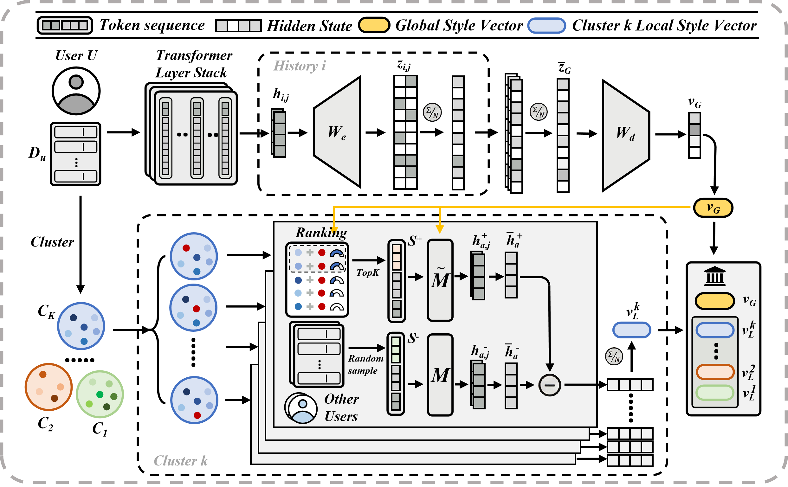

# From Profiles to Steering Vectors: Global Sparse Priors and Local Semantic Calibration for Personalized Text Generation

[](https://arxiv.org/abs/2607.21620)
[](https://huggingface.co/datasets/FestinaLente123/GLASS-artifacts)

[English](README.md) | [简体中文](README_zh.md)

GLASS（Global–Local Activation Steering with Sparse priors）从用户的历史回答中构建全局风格方向，并根据该用户历史记录的聚类结果构建局部对比方向库。推理时，在冻结语言模型的两个残差流层中，分别注入全局方向和选定的局部方向。

<p align="center">
  
</p>

## 前期准备

### 环境

所有阶段使用同一个 Python 3.12 环境。按 `requirements.txt` 安装依赖，包括 NumPy 2.2.6、PyTorch 2.8.0+cu126 和 Transformers 4.57.1。

```bash
conda create -n glass python=3.12 pip -y
conda activate glass
python -m pip install -r requirements.txt
python -m pip install -e . --no-deps
python -m pip check
```

ROUGE-1 和 ROUGE-L 使用 `rouge-score`，已包含在依赖中。如需额外计算 METEOR（在单阶段评分命令中设置 `--set meteor=true`），请在离线运行前下载 NLTK 资源：

```bash
python -m nltk.downloader punkt punkt_tab wordnet omw-1.4
```

生成和评分阶段不会自动下载这些资源。

### 模型

基础模型是 **Meta-Llama-3-8B base**。SAE 使用 `EleutherAI/sae-llama-3-8b-32x-v2` 提供的预训练 32 倍扩展模型，选择其中的 `layers.19` 检查点。

| 组件 | 下载地址 |
| --- | --- |
| 基础模型 | [Meta-Llama-3-8B](https://huggingface.co/meta-llama/Meta-Llama-3-8B) · [模型文件](https://huggingface.co/meta-llama/Meta-Llama-3-8B/tree/main) |
| SAE 第 19 层 | [检查点文件](https://huggingface.co/EleutherAI/sae-llama-3-8b-32x-v2/tree/main/layers.19) |

在 [configs/paths.json](configs/paths.json) 中填写本地权重路径：

```json
{
  "model_path": "models/Meta-Llama-3-8B",
  "sae_model_path": "models/sae-llama-3-8b-32x-v2/layers.19"
}
```

### 数据集

从原始数据重新实验时，下载以下官方数据，并按下方目录保存。Hugging Face 产物仓库提供处理后的中间文件和元数据，不包含原始 benchmark 文件；原始文件需从下列官方来源单独获取。仅使用现成中间产物时，可直接进入“快速开始”。

| 任务 | `--tasks` | 官方原始数据 | 保存位置 |
| --- | --- | --- | --- |
| LaMP-4 | `lamp4` | [训练文件](https://ciir.cs.umass.edu/downloads/LaMP/time/LaMP_4/train/) · [验证文件](https://ciir.cs.umass.edu/downloads/LaMP/time/LaMP_4/dev/) | `artifacts/LaMP_4/raw/` |
| LaMP-5 | `lamp5` | [训练文件](https://ciir.cs.umass.edu/downloads/LaMP/time/LaMP_5/train/) · [验证文件](https://ciir.cs.umass.edu/downloads/LaMP/time/LaMP_5/dev/) | `artifacts/LaMP_5/raw/` |
| LongLaMP-3 | `longlamp3` | [商品评论 temporal 文件](https://huggingface.co/datasets/LongLaMP/LongLaMP/tree/main/product_review_temporal) | `artifacts/product_review_temporal/raw/` |
| LongLaMP-4 | `longlamp4` | [帖子写作 temporal 文件](https://huggingface.co/datasets/LongLaMP/LongLaMP/tree/main/topic_writing_temporal) | `artifacts/topic_writing_temporal/raw/` |

LaMP 使用 **time-based split**：下载训练目录中的两个 JSON，放入 `raw/train/`；下载验证目录中的两个 JSON，放入 `raw/valid/`，保留文件名 `dev_questions.json` 和 `dev_outputs.json`。LongLaMP 下载各任务的全部 `train-*.parquet` 和 `test-*.parquet`，直接放入该任务的 `raw/`。这些数据集的划分说明见 [LaMP 下载页](https://lamp-benchmark.github.io/download)和 [LongLaMP 数据页](https://huggingface.co/datasets/LongLaMP/LongLaMP)。

```text
artifacts/
├── LaMP_4/raw/
│   ├── train/{train_questions.json,train_outputs.json}
│   └── valid/{dev_questions.json,dev_outputs.json}
├── LaMP_5/raw/
│   ├── train/{train_questions.json,train_outputs.json}
│   └── valid/{dev_questions.json,dev_outputs.json}
├── product_review_temporal/raw/
│   ├── test-00000-of-00001.parquet
│   ├── train-00000-of-00003.parquet
│   ├── train-00001-of-00003.parquet
│   └── train-00002-of-00003.parquet
└── topic_writing_temporal/raw/
    ├── test-00000-of-00001.parquet
    ├── train-00000-of-00004.parquet
    ├── train-00001-of-00004.parquet
    ├── train-00002-of-00004.parquet
    └── train-00003-of-00004.parquet
```

## 快速开始

### 1. 下载所有中间产物

从 [FestinaLente123/GLASS-artifacts](https://huggingface.co/datasets/FestinaLente123/GLASS-artifacts) 一次下载四个任务的中间文件，包括整理后的 train/test、聚类与 anchors、全局／局部向量和 Stage1/2 输出：

```bash
hf download FestinaLente123/GLASS-artifacts --repo-type dataset \
  --include 'artifacts/**' --local-dir .
```

下载的中间产物保存在项目根目录的 `artifacts/` 下。LaMP 的固定选择文件也保存在所属任务目录：`artifacts/LaMP_4/LaMP_4_users.json`、`artifacts/LaMP_4/LaMP_4_target_indices.json`，以及 `artifacts/LaMP_5/` 下对应的两份文件。

### 2. 使用现成向量直接预测与评分

使用下载的测试分簇、全局向量和局部向量运行 Stage3，无需重跑 Stage1/2 或加载 SAE。以下以 LaMP-4 为例：

```bash
bash scripts/predict.sh --tasks lamp4 --gpus 0 --run runs/quick_predict
```

预测文本保存在 `runs/quick_predict/LaMP_4/generation.json`，ROUGE-1 和 ROUGE-L 得分保存在同目录的 `metrics.json`。其他任务替换 `--tasks` 的值即可。

### 3. 独立运行各块

每条命令使用单独的新输出目录，并从下载的中间产物读取输入，可独立运行，无需先执行其他命令：

| 检查内容 | 使用的现成输入 |
| --- | --- |
| 数据聚类与 anchors | `train.pkl`、`test.pkl`，以及 LaMP 的参考选择元数据 |
| 全局向量 | `train.pkl` 和本地基础模型／SAE |
| Stage1/2 与局部向量 | `anchors.pkl`、`global.pt` 和基础模型 |
| Stage3 与评分 | `test_clusters.pkl`、`global.pt`、`local/` 和基础模型 |

```bash
bash scripts/prepare_data.sh --tasks lamp4 --from cluster \
  --reference-selection --run runs/check_data
bash scripts/build_global.sh --tasks lamp4 --gpus 0 --run runs/check_global
bash scripts/build_local.sh --tasks lamp4 --gpus 0 --run runs/check_local
bash scripts/predict.sh --tasks lamp4 --gpus 0 --run runs/check_predict
```

`--reference-selection` 用于复用参考产物中的样本选择：

- **LaMP-4、LaMP-5**：本发布的选择文件固定配套产物使用的用户与 anchor。Anchor 抽样使用以 seed 42 初始化的共享随机数流，按用户、簇的顺序遍历；相同输入和遍历顺序可重建本发布的 anchor 选择。`*_users.json` 在数据准备阶段固定用户；`*_target_indices.json` 按各历史簇内的零起始位置固定 anchor。
- **LongLaMP-3、LongLaMP-4**：anchor 抽样按用户和簇分别派生独立 seed，无需另附选择文件。聚类、anchors 和测试分簇与参考产物的对齐已验证前五个用户。

从原始数据进行新实验时，四个任务都按配置中的 seed 抽样，不依赖这些固定选择文件；只有显式添加 `--reference-selection`，才会读取 LaMP 的选择文件。

也可以只从 Stage2 开始，或只重新提取局部向量：

```bash
bash scripts/build_local.sh --tasks lamp4 --from pairs \
  --gpus 0 --run runs/check_pairs
bash scripts/build_local.sh --tasks lamp4 --from local \
  --gpus 0 --run runs/check_local_only
```

`--from` 选择起始阶段，`--until` 指定结束阶段；`--dry-run` 仅显示计划。各起点的输入依赖见[工作流](docs/workflow_zh.md#从中间产物开始)。

## 完整流程

按“前期准备”放好原始数据和模型后，依次运行以下四块，从原始数据重新构建全部中间结果。以下以 LaMP-4 为例；多个任务可一起指定，例如 `--tasks lamp4 lamp5`，省略 `--tasks` 则依次运行四个任务。

1. **整理数据与聚类（`prepare` → `cluster`）**：整理用户训练历史和测试问题，对历史记录聚类，抽取训练 anchors，并分配测试簇。输出 `train.pkl`、`test.pkl`、`clusters.json`、`anchors.pkl` 和 `test_clusters.pkl`。

   ```bash
   bash scripts/prepare_data.sh --tasks lamp4
   ```

2. **构建全局向量（`global`）**：以 teacher forcing 方式输入训练历史回答，通过 SAE 编码第 19 层激活，对稀疏编码求均值并解码为用户全局方向。输入为 `train.pkl` 和本地模型／SAE；输出 `global.pt`。

   ```bash
   bash scripts/build_global.sh --tasks lamp4 --gpus 0
   ```

3. **构建局部向量（`rank` → `pairs` → `local`）**：使用 anchors 和全局方向排序示例（Stage1）、生成和筛选正负样本对（Stage2），再提取局部方向。输入为 `anchors.pkl`、`global.pt` 和基础模型；输出 `ranked.json`、`accepted.json`、`rejected.json` 和 `local/`。

   ```bash
   bash scripts/build_local.sh --tasks lamp4 --gpus 0
   ```

4. **预测与评分（`generate` → `evaluate`）**：读取测试分簇和全局／局部向量，在冻结模型中注入方向并进行贪心解码（Stage3），计算 ROUGE-1 和 ROUGE-L。输出 `generation.json` 和 `metrics.json`。

   ```bash
   bash scripts/predict.sh --tasks lamp4 --gpus 0
   ```

也可以用一个命令串联全部步骤：

```bash
bash scripts/run_all.sh --tasks lamp4 --gpus 0
```

上述完整流程的结果保存在 `runs/<dataset>/`。如需另开一次实验，可为各块或 `run_all.sh` 指定相同的新 `--run` 目录。

## 并行与显卡需求

### 多卡运行

模型阶段按完整用户划分多卡分片，每张 GPU 独立加载一份模型，完成后按输入顺序合并。以下命令使用八张卡运行 Stage1、Stage2 和局部向量构建：

```bash
bash scripts/build_local.sh --tasks lamp4 --gpus 0 1 2 3 4 5 6 7
```

其他模型脚本也接受同样的 `--gpus` 参数；CPU 聚类可用 `--cluster-workers 2` 设置并行进程数。阶段日志和实际配置保存在运行目录内，分片日志位于输出旁的 `*.shards/` 目录。

### 显存与耗时

耗时参考硬件为 **8 × NVIDIA RTX 3090，每卡 24 GB 显存**。多卡采用独立模型分片，每张卡均需容纳模型及该阶段的激活。

| 数据集 | 运行时间参考 | 计时条件 |
| --- | ---: | --- |
| LaMP-4 | 约 3 小时 | Stage1 batch=2，Stage2 batch=1 |
| LaMP-5 | 约 2.5 小时 | Stage1 batch=2，Stage2 batch=1 |
| LongLaMP-3 / Product Review | 约 28 小时 | Stage1/2 batch=2 |
| LongLaMP-4 / Topic Writing | 约 12.5 小时 | Stage1/2 batch=2 |

## 引用

```bibtex
@article{chen_glass,
  title={From Profiles to Steering Vectors: Global Sparse Priors and Local Semantic Calibration for Personalized Text Generation},
  author={Chen, Liuji and Zhang, Zeyu and Zhang, Xinyuan and Nie, Shuai and Liu, Qiang and Wu, Shu and Wang, Liang}
}
```
